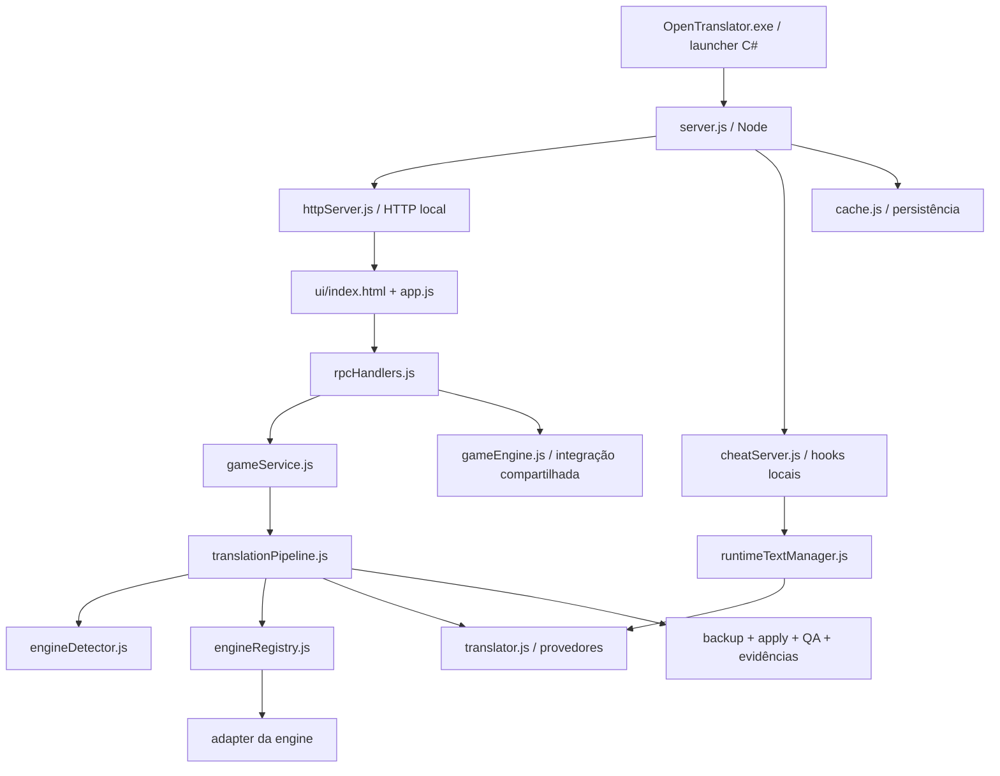
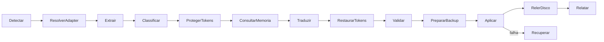

# OpenTranslator — guia detalhado do projeto

Documentação do estado local em **1 de novembro de 2026**.

## 1. Como ler esta documentação

O OpenTranslator é um aplicativo desktop para Windows cuja interface é exibida por um navegador local. Ele combina um launcher C#, um servidor Node.js, uma interface HTML/CSS/JavaScript, adapters de engines e ferramentas auxiliares, incluindo componentes Python e binários nativos.

Há três materiais complementares:

1. **Este guia:** explica responsabilidades, arquitetura, fluxos, dados e manutenção.
2. **CATALOGO-DO-CODIGO.md:** descreve cada arquivo de código/configuração/teste, com assinaturas localizadas e referências estáticas.
3. **Catálogo local pesquisável:** `index.html`, `inventario.csv`, `inventario.json` e `CATALOGO-COMPLETO.md`, entregues na pasta de documentação ao lado do projeto. Inclui dependências, recursos e arquivos locais.

Os textos elegíveis foram lidos integralmente pelo gerador. Binários e dados locais receberam inventário de bytes, tamanho e hash, sem interpretação de seu funcionamento interno. Isso não equivale a uma auditoria humana linha por linha. As descrições do catálogo informam se são editoriais, inferidas da estrutura ou extraídas de cabeçalhos. Um comentário que anuncia suporte não é evidência de que todos os jogos funcionem.

O catálogo representa uma fotografia: arquivos de log, bancos e trabalhos em andamento podem mudar depois da coleta. Após a reorganização, históricos/laboratórios foram retirados da árvore ativa e preservados em arquivo compactado externo. O pacote padrão exclui o injetor nativo opcional; o perfil `complete` o inclui quando disponível. Consulte `ORGANIZACAO-E-DISTRIBUICAO.md`. O histórico interno `.git` fica fora da documentação funcional. Os arquivos da própria documentação gerada não constituem parte do runtime do programa.

## 2. Visão geral da arquitetura

Há caminhos novos e caminhos legados coexistindo. A presença de `gameService.js` não significa que todas as operações passem por ele: `rpcHandlers.js` também chama funções de `gameEngine.js` e serviços específicos. Da mesma forma, versões de memória de tradução e roteadores diferentes coexistem. O catálogo de imports ajuda a identificar o consumidor concreto antes de alterar um módulo.

### As três interfaces principais

| Interface | Responsabilidade | Observação |
| --- | --- | --- |
| Janela principal HTML | Biblioteca, preferências, compatibilidade, salvamentos, cheats e diagnóstico | Fica em `ui/` |
| Backend HTTP local | Entregar a interface e atender operações RPC | Porta padrão 8080; não é hospedagem pública |
| Hook de jogo | Receber estado e textos de runtime e entregar comandos | Porta padrão 16005, HTTP e WebSocket |

O endereço e o protocolo fazem parte da integração. Mudar a porta do backend não garante que os templates de jogos ou ferramentas externas passem a usar outra porta de hooks.

## 3. Responsabilidade de cada pasta

| Pasta | Para que serve | Relação com a execução |
| --- | --- | --- |
| `.agents/` | Instruções e recursos usados por agentes de desenvolvimento | Não é backend do aplicativo |
| `.github/` | Workflows de verificação e release | Executado pelo GitHub Actions |
| `archives/` | Cópias históricas, manutenção pontual e evidências antigas | Não usar como referência automática da versão atual |
| `bin/` | Runtime portátil e componentes de execução | Necessário conforme o modo de distribuição |
| `config/` | Catálogos e regras distribuídas | Pode ser carregado pelo código em produção |
| `data/` | Preferências, bancos, cache, logs estruturados, sessões e jobs | Estado mutável do usuário/aplicativo |
| `docs/` | Guias, arquitetura, relatórios e evidências | Material de consulta; há documentos históricos |
| `gameLib/` | Metadados dos jogos cadastrados | Biblioteca pessoal, não código |
| `graphify-out/` | Resultados de análise de grafo | Material gerado |
| `launcher/` | Fonte do launcher Windows | Compilado para o executável da raiz |
| `loaders/` | Injetores, hooks, fontes e ferramentas nativas | Disponibilidade e arquitetura variam |
| `logs/` | Registros operacionais adicionais | Não comprova implementação ou cobertura |
| `node_modules/` | Dependências instaladas pelo npm | Geradas a partir do lockfile |
| `resources/` | Templates, pontes, runtimes e recursos de integrações | Parte deles é código de terceiros ou binário |
| `scratch/` | Testes, capturas e trabalho temporário | Não integra automaticamente o portable |
| `src/` | Código do backend e integrações | Núcleo do produto |
| `tests/` | Testes registrados e roteiros históricos/de laboratório | Só as suítes do runner principal entram no comando padrão |
| `third-party/` | Componentes externos e material de procedência/licença | Verificar o componente específico |
| `Tool/` e `src/Tool/` | Estruturas legadas locais, quando presentes | Não assumir que substituam `data/` atual |
| `ui/` | Interface exibida pelo navegador | Carregada pelo servidor HTTP |
| `UNITY_GAMEPLAY_EVIDENCE/` | Evidência local de sessões Unity, quando presente | Não certifica a engine inteira |

Algumas pastas estão vazias e, por isso, não aparecem como arquivos no inventário. Também há dados antigos em locais como `src/data/`. Eles não devem ser confundidos com código apenas por estarem dentro de `src/`.

## 4. Arquivos da raiz

- **`OpenTranslator.exe`:** launcher compilado. Ele diagnostica o ambiente, inicia o backend, abre a interface e mantém acesso ao painel pela bandeja. O modo `--safe` ou `--software-rendering` solicita a interface sem aceleração gráfica. O código correspondente está em `launcher/OpenTranslatorLauncher.cs`.
- **`server.js`:** entrada do backend. Define caminhos globais, configura estado inicial e logs, carrega o cache e inicia os servidores. Instala o coordenador de encerramento. `--no-browser` deixa a abertura da interface sob responsabilidade do launcher ou de um teste.
- **`package.json`:** nome, versão, dependências diretas e comandos. A descrição comercial do pacote não constitui declaração de compatibilidade universal.
- **`package-lock.json`:** versões resolvidas e integridade de dependências. Permite reproduzir a instalação com `npm ci`.
- **`README.md` e `CHANGELOG.md`:** apresentação e histórico. Podem descrever estágios diferentes do desenvolvimento.
- **`LICENSE`:** licença do projeto. Componentes externos podem ter licenças próprias.
- **`.gitignore`:** define itens normalmente excluídos do versionamento; não decide quais arquivos o aplicativo precisa para executar.
- **`skills-lock.json`:** registro de recursos de desenvolvimento, distinto do lockfile npm.
- **`OpenTranslator.png`:** recurso visual do produto.

## 5. Inicialização e encerramento

### Inicialização normal

1. O launcher verifica instância existente e executa diagnóstico.
2. Localiza o runtime Node e a raiz do produto.
3. Inicia `server.js --no-browser`, acompanhando o processo iniciado.
4. O backend configura `ROOT`, `WWW_DIR`, `GL_DIR`, `DATA_DIR`, caminhos de preferências e logs.
5. O serviço de cache inicializa armazenamento; o servidor HTTP passa a atender o navegador.
6. O servidor de hooks começa a receber conexões de integrações de jogos.
7. O launcher abre a interface. Após sucesso, o painel recolhe para a bandeja no modo normal.
8. A interface obtém dados da sessão, preferências e biblioteca, e passa a consultar estado e logs.

O launcher não deve interpretar o encerramento do processo inicial do Chromium como falha: o navegador pode entregar a abertura a um processo já existente. A correção de abertura duplicada está nesse fluxo.

### Encerramento

`shutdownCoordinator.js` compartilha o caminho de encerramento entre sinais e requisições HTTP. Ele acompanha operações, restaura backups pendentes, registra etapas e fecha os serviços. `legacyGameRestore.js` cuida da restauração do fluxo legado, preservando evidências para recuperação.

Não basta finalizar o processo Node para afirmar que um jogo foi restaurado. O resultado depende do retorno das etapas e da integridade dos arquivos. Para diagnóstico, consultar logs, manifestos e relatórios de encerramento.

## 6. O que acontece quando se traduz um jogo

### Detecção e estratégia

`engineDetector.js` usa estrutura de arquivos, marcadores de runtime e informações do executável. `executableInfo.js` diferencia x86, x64 e ARM64. Desconhecido é um resultado válido: não deve virar automaticamente RPG Maker MZ ou 32 bits.

`engineRegistry.js` resolve o adapter. `strategyPlanner.js`, roteadores, políticas e a tríade engine/runtime/hook complementam as escolhas em diferentes caminhos. Um detector reconhecer uma engine não significa que seu formato empacotado ou um hook específico esteja disponível.

### Extração e identidade

Adapters e extratores leem estruturas diferentes. `buildUniverse.js`, classificadores e módulos de identidade/proveniência ajudam a distinguir texto de jogo, lixo técnico, código e conteúdo que não foi visto.

A identidade deve incluir contexto suficiente. Dois arquivos de mesmo nome em pastas diferentes podem ter traduções diferentes; Defold e Cocos usam caminho relativo nos identificadores dos casos corrigidos.

### Tradução e cache

`translator.js` oferece tradução individual e em lote. Usa serviços de transporte, gateway, limitadores e mecanismos de espera. Preferências podem selecionar provedores externos ou locais conforme a implementação correspondente.

`codeProtector.js` e validadores preservam marcadores que o jogo interpreta. Glossários e memórias ajudam a reutilizar traduções. Um acerto de cache e uma requisição externa são operações diferentes, e medições não devem confundir suas velocidades.

### Aplicação e evidência

`backupManager.js`, `applyContract.js`, `applyTransaction.js`, `applyVerifier.js`, `transactionJournal.js`, `partialApply.js` e `translationCertificate.js` tratam aspectos complementares da gravação e do resultado.

Um arquivo gerado não prova que o jogo o carregou. Um caso importante é o adapter Construct: criar uma tradução adicional exige integração com o mecanismo de carregamento do jogo. Texto em imagens, fontes, vídeos e estruturas compiladas também pode ficar fora do caminho estático.

### Dry-run

`TranslationPipeline.dryRun()` executa detecção, extração e uma amostra de QA, sem o caminho de aplicação de traduções. É diagnóstico do pipeline, não prova de execução do jogo ou de que ferramentas externas sejam livres de efeitos laterais. Seus campos devem ser interpretados junto com o retorno da extração.

## 7. Engines, adapters e formatos

O registro atual instancia **15 adapters**, enquanto o catálogo visual de compatibilidade contém **22 perfis**. Os números medem coisas diferentes: alguns perfis ainda não possuem adapter dedicado e algumas famílias possuem mais de um adapter.

| Adapter registrado | Arquivo principal | Papel e limite de escopo |
| --- | --- | --- |
| RenPy | `src/engines/renpy/adapter/renpyAdapter.js` | Scripts/camada de tradução e recursos RenPy; a entrada superior é um encaminhamento |
| RPG Maker | `src/engines/rpgmaker/rpgMakerAdapter.js` | Dados e integração MV/MZ; plugins variam por jogo |
| RGSS | `src/engines/rpgmaker/rgssAdapter.js` | Dados Ruby/Marshal e containers específicos de XP/VX/Ace |
| Unity | `src/engines/unity/unityAdapter.js` | Recursos, pontes e caminhos diferentes para Mono/IL2CPP |
| Unreal | `src/engines/unreal/unrealAdapter.js` | Localização e pacotes conforme providers disponíveis |
| Godot | `src/engines/godot/godotAdapter.js` | Recursos de localização, arquivos abertos e ponte para pacotes |
| GameMaker | `src/engines/gamemaker/gameMakerAdapter.js` | Texto externo; dados compilados dependem de integração específica |
| Construct | `src/engines/construct/constructAdapter.js` | Estruturas legíveis e arquivo de tradução adicional; carregamento precisa ser comprovado |
| Defold | `src/engines/defold/defoldAdapter.js` | Arquivos de localização acessíveis, não toda exportação compilada |
| Cocos Creator | `src/engines/cocos/cocosCreatorAdapter.js` | Recursos acessíveis de i18n; scripts cifrados exigem outro tratamento |
| Cocos2d-x | `src/engines/cocos/cocos2dxAdapter.js` | Recursos textuais como XML/plist/JSON/Lua, conforme código |
| Wolf | `src/engines/wolf/wolfAdapter.js` | Ponte Python e formatos específicos; versão/encoding importam |
| GDevelop | `src/engines/gdevelop/gdevelopAdapter.js` | Objetos textuais em estruturas JSON reconhecidas |
| Electron | `src/engines/electron/electronAdapter.js` | Recursos abertos e ASAR básico; variantes não preservadas são recusadas |
| Generic | `src/engines/generic/genericAdapter.js` | Formatos reconhecidos sem conhecimento completo da lógica do jogo |

Adapters de engine não são os mesmos objetos que adapters de formato em `formatAdapterRegistry.js`. Um formato JSON pode existir em várias engines, com semânticas diferentes. Uma extensão de arquivo não basta para identificar o que é texto traduzível.

Para detalhes por versão, consultar `config/engineCompatibility.json` e o relatório `docs/audit/ENGINE-BY-ENGINE-2026-11-01.md`.

## 8. Interface e preferências

`ui/app.js` combina renderização e controle de telas. Ele mantém estado local da biblioteca, preferências, jogo iniciado e ações de runtime. Usa RPC para operações que precisam do sistema de arquivos, banco ou processos.

- **Biblioteca:** cadastro, busca, ordenação, edição, remoção e início de jogos.
- **Salvamentos:** consulta e operações conforme handlers disponíveis; não é um backup universal de todo save de toda engine.
- **Configurações:** idiomas, provedor, parâmetros de tradução, glossário, leitura e biblioteca; ferramentas e diagnóstico ficam agrupados.
- **Compatibilidade:** cartões pesquisáveis que mostram escopo, pendências e fontes. Não são selos de teste universal.
- **Cheats:** estado e controles de jogos conectados ao protocolo esperado.
- **Log:** visualiza registros retornados pelo backend.

`base.css` preserva componentes e estilos de base; `layout.css` define a apresentação atual e adaptações de janela. `xssGuard.js` escapa valores exibidos. Os arquivos da interface usam controle de cache para evitar mostrar código antigo após atualização.

## 9. RPC, hooks e comunicação

`httpServer.js` atende bootstrap, saúde, heartbeat, encerramento, RPC e arquivos estáticos. O RPC usa o token de sessão e despacha métodos de `rpcHandlers.js`. `rpcResponse.js` padroniza resultados; um retorno precisa ser interpretado pelo status, não apenas pela existência de um objeto.

Rotas identificadas no servidor incluem `/api/rpc`, `/api/ping`, `/api/health`, `/health`, `/api/heartbeat`, `/api/close_app` e `/api/shutdown`. Algumas rotas são aliases ou têm requisitos de método/cabeçalho específicos. A referência gerada de RPC lista as assinaturas atuais; não inclui credenciais ou valores de preferências.

No hook da porta 16005, HTTP e WebSocket atendem integrações diferentes. O template RPG Maker publica estado via `/cheat_poll`, recebe comandos e executa no contexto do jogo. Conexão de tradução não implica necessariamente capacidade de editar atributos.

## 10. Cheats e runtime

`resources/templates/CheatOverlayTemplate.js` observa APIs RPG Maker e oferece recursos como dinheiro, HP/MP, variáveis/switches, velocidade e atalhos. O servidor mantém estado recebido, socket ativo ou fila de comandos. Uma entrega enfileirada não é confirmação de alteração no jogo.

O overlay informa prontidão do runtime. Sem objetos de gameplay, a interface deve aguardar. Controles RPG Maker não devem ser exibidos como comandos genéricos de RenPy. RenPy e outras engines dependem de suas pontes e modelos de variáveis.

`runtimeSessionManager.js` acompanha sessões; `runtimeTextManager.js` trata textos capturados; probes, watchdogs e módulos de captura/QA visual complementam observação e diagnóstico. A presença desses módulos não prova cobertura de cada framework gráfico.

## 11. Dados e persistência

| Tipo | Local ou módulo associado | Finalidade |
| --- | --- | --- |
| Preferências | `data/openT.json`, serviço `cache.js` | Idiomas, provedor e preferências da interface |
| Biblioteca | `gameLib/` | Metadados e caminhos de jogos cadastrados |
| Cache | `cache.js` e bancos locais | Reaproveitar traduções já obtidas |
| Memória contextual | `translationMemory.js` e implementações relacionadas | Prioridade/contexto de traduções e glossários |
| Jobs | `data/jobs/`, `jobSystem.js`, `jobPersistence.js` | Progresso, checkpoint e retomada |
| Sessões | `data/sessions/` e runtime | Estado operacional e recuperação |
| Transações/staging | Journal e políticas de staging | Preparação e recuperação de alterações |
| Logs | Logger e arquivos em `data/`/`logs/` | Diagnóstico e evidências operacionais |
| Backups de jogos | Gerenciadores e diretórios específicos | Restaurar arquivos originais com manifesto |

Arquivos SQLite `-wal` e `-shm` participam do funcionamento de bancos abertos. Não devem ser tratados como cópias descartáveis durante uso do programa. Bancos, jobs e backups não são equivalentes: um cache de tradução não substitui os arquivos originais do jogo.

O inventário local não transcreve textos de jogos, chaves de API ou valores de preferências. Seu objetivo é localizar e classificar arquivos, não exportar a biblioteca pessoal.

## 12. Dependências e componentes externos

As dependências npm diretas são `better-sqlite3` (SQLite nativo), `exceljs` (planilhas) e `ws` (WebSocket). As versões efetivamente resolvidas estão no lockfile. `node_modules/` inclui ainda dependências transitivas, documentação e testes de terceiros.

`resources/`, `loaders/`, `bin/` e `third-party/` podem conter Python incorporado, bibliotecas, injetores, fontes, ferramentas de pacotes e templates. Um `.exe` ou `.dll` inventariado recebeu hash e classificação; isso não significa revisão de seu código-fonte. Componentes opcionais ausentes não são supridos pela simples existência de um caminho no código.

Versões, arquitetura, licença e procedência devem ser verificados por componente. Não substituir automaticamente um hook pelo de outro produto só porque o nome é parecido.

## 13. Testes, ferramentas e comandos

| Comando | O que faz |
| --- | --- |
| `npm start` | Executa o backend via `server.js` |
| `node server.js --no-browser` | Executa o backend sem abertura automática da interface |
| `npm test` | Executa as suítes registradas em `tests/index.js` |
| `npm run test:unit` | Seleciona o grupo unit do runner |
| `npm run test:security` | Seleciona o grupo security |
| `npm run test:bail` | Interrompe o runner na primeira falha |
| `npm run lint` | Verifica sintaxe e regras do repositório |
| `npm run audit:success` | Analisa contratos/padrões relacionados a declarações de sucesso |
| `npm run verify` | Executa lint, auditoria de sucesso e testes registrados |
| `npm run smoke` | Executa o teste de inicialização do launcher |
| `npm run package:portable -- --output DESTINO` | Monta o portable conforme a interface de argumentos de `package_release.js`; confirmar o uso da versão local antes de executar |
| `python -X utf8 tools/document_project.py` | Atualiza catálogo local, inventário e catálogo público de código |

Os scripts `legacy:*` e vários arquivos soltos em `tests/` são históricos ou roteiros próprios. Não interpretar a quantidade de arquivos de teste como quantidade de suítes executadas no comando padrão. O runner atualmente registra 41 suítes; a entrega de organização passou 615 testes. Esta documentação não executa jogos ou traduz textos para ser gerada.

Ferramentas em `tools/` têm impactos diferentes. `package_release.js` monta distribuição; `repoLint.js` inspeciona código; `translate-locres.js` traduz recursos de localização; scripts de captura e interação são de laboratório. Consultar conteúdo/argumentos do arquivo antes de tratar todos como utilitários sem efeitos.

## 14. Como localizar uma função e planejar uma alteração

1. Identificar a ação do usuário e seu controle em `ui/app.js`.
2. Localizar a chamada `rpc` e o método em `rpcHandlers.js`.
3. Verificar se o método usa serviço, pipeline, função legada ou integração específica.
4. Consultar imports e referências recebidas no catálogo.
5. Localizar o adapter e os formatos realmente usados no jogo.
6. Identificar quais arquivos serão escritos, onde o backup é criado e como o resultado é verificado.
7. Usar as suítes do comportamento afetado. Um teste de contrato, uma fixture e um jogo real dão evidências diferentes.
8. Atualizar documentação e catálogo quando caminhos ou responsabilidades mudarem.

Imports dinâmicos, caminhos construídos em runtime, templates copiados para jogos e executáveis externos não formam necessariamente uma ligação detectável pelo catálogo estático. Ausência de uma referência no catálogo não é prova de arquivo inútil.

## 15. Pontos que exigem interpretação cuidadosa

- O registro possui 15 adapters; documentos/testes antigos com número fixo 14 não são inventário atual.
- Os 22 perfis visuais incluem engines com integração pendente. Não são 22 implementações completas.
- `translationMemory.js` e `translationMemory3.js`, roteadores e fluxos legados coexistem. O nome mais novo não identifica sozinho o caminho ativo.
- Há `validate()` com validação limitada em adapters. O catálogo lista o método, mas não o transforma em validação completa.
- Constantes e comentários que citam todas as versões, suporte universal ou percentual de sucesso podem ser históricos ou declarações não comprovadas.
- Dados em `src/data/`, cópias `.bak`, saídas de laboratório e arquivos arquivados precisam ser separados da implementação atual ao interpretar a estrutura.
- Binários, criptografia de pacotes, texto renderizado como imagem e recursos compilados exigem análise própria, que não é substituída por leitura de nomes/extensões.

## 16. Glossário

- **Adapter de engine:** implementação que conhece a estrutura de um motor de jogo.
- **Adapter de formato:** leitor/escritor de um formato como JSON ou CSV.
- **Hook:** componente conectado ao jogo para observar ou alterar comportamento/texto em execução.
- **Runtime:** ambiente no qual o jogo ou o aplicativo está executando.
- **RPC:** operação solicitada pela interface ao backend local.
- **Placeholder/token:** marcador que precisa sobreviver à tradução para manter a interpretação do jogo.
- **Staging:** diretório de preparação, distinto da gravação final.
- **Rollback:** restauração após uma alteração ou falha.
- **Checkpoint:** estado persistido para retomar uma tarefa.
- **Hash SHA-256:** impressão digital dos bytes de um arquivo; não explica sua função.
- **Evidência:** informação que sustenta uma conclusão dentro de um escopo identificado.

## 17. Material complementar

- `CATALOGO-DO-CODIGO.md`: descrição e referências por arquivo de código.
- `REFERENCIA-RPC.md`: métodos encontrados no objeto de handlers e assinaturas.
- `PROJECT-STRUCTURE.md`: índice alfabético de arquivos do projeto.
- `audit/ENGINE-BY-ENGINE-2026-11-01.md`: limitações, cheats, MTool e revisão por engine.
- `audit/UNREAL_REAL_GAME_TEST_2026-10-31.md`: evidência restrita ao teste de jogo Unreal descrito nesse relatório.
- Catálogo local: `index.html` e `CATALOGO-COMPLETO.md` na pasta entregue de documentação.
